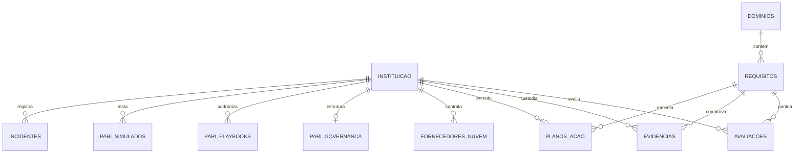

# Arquitetura do Software e Guia Técnico de Conformidade GRC

Sistema Web Especializado para Gestão de Governança, Riscos e Conformidade (GRC) com as Resoluções do Banco Central do Brasil / Conselho Monetário Nacional **CMN nº 4.893/2021** e **CMN nº 5.274/2025**.

---

## 1. Princípios de Engenharia de Software

1. **Autocontido e Zero Dependências Externas em Tempo de Execução:**
   - Construído integralmente com a biblioteca padrão do Python 3 (`http.server`, `sqlite3`, `json`, `hashlib`, `urllib`).
   - Não requer servidores de aplicação pesados ou bibliotecas externas não auditadas, atendendo às mais estritas políticas de segurança de instituições financeiras.
2. **Integridade Criptográfica de Evidências:**
   - Cada evidência registrada recebe cálculo automático de hash **SHA-256** no momento da ingestão, permitindo comprovação pericial de não repúdio e não adulteração perante a auditoria do Banco Central.
3. **Persistência Transacional Confiável (ACID):**
   - Banco de dados relacional embarcado SQLite operando com integridade referencial ativa (`PRAGMA foreign_keys = ON;`), transações atômicas e isolamento.
4. **Interface Moderna Single Page Application (SPA):**
   - Frontend executivo rápido em HTML5, CSS3 moderno e JavaScript ES6+, com suporte nativo a impressão e geração de dossiês em PDF (`window.print()`).

---

## 2. Estrutura do Esquema de Dados (Database Schema)

### Tabelas Principais
* `instituicao`: Cadastro da instituição financeira, CNPJ, segmento S1 a S5, tipo de instituição, registro Unicad e diretor estatutário (Art. 7º).
* `dominios`: Os 7 domínios de governança regulatória.
* `requisitos`: Os 32 requisitos normativos com referência legal, especificação técnica, flag dos 14 controles mandatórios da 5.274 e severidade.
* `avaliacoes`: Status GRC (`atendido`, `parcialmente_atendido`, `em_implementacao`, `nao_atendido`, `nao_aplicavel`), aderência percentual (0 a 100%), justificativa técnica, responsável e observações da auditoria.
* `evidencias`: Cofre de evidências com hash criptográfico SHA-256, tipo de documento, data de coleta e status pericial de validação.
* `pari_governanca`: Estrutura do CSIRT, plantão 24x7, membros, comitê de crise executivo e critérios formais de comunicação ao BACEN.
* `pari_playbooks`: Procedimentos operacionais padronizados por cenário (Ransomware, Vazamento de Dados, DDoS, Nuvem, RSFN/PIX) cobrindo as 5 fases de resposta.
* `pari_simulados`: Histórico de exercícios de mesa (tabletop drills) com a Diretoria, tempo de resposta alcançado e lições aprendidas.
* `planos_acao`: Matriz 5W2H de remediação para gaps regulatórios.
* `fornecedores_nuvem`: Cadastro de provedores (IaaS, PaaS, SaaS) e checklist de conformidade com os Arts. 11 a 17 da Resolução 4.893.
* `incidentes`: Registro de eventos de segurança, criticidade e notificação regulatória no Sisbacen.
* `auditoria_log`: Trilha imutável de todas as modificações realizadas no sistema.

---

## 3. Especificação da REST API

| Método | Endpoint | Descrição |
|:-------|:---------|:----------|
| `GET` | `/api/dashboard` | Retorna métricas globais de conformidade, KPIs, breakdown dos 14 controles da 5.274 e estatísticas por domínio. |
| `GET` | `/api/instituicoes` | Lista todas as instituições cadastradas no sistema. |
| `GET` | `/api/instituicao/ativa` | Retorna os dados da instituição atualmente ativa para avaliação. |
| `POST` | `/api/instituicoes` | Cadastra uma nova instituição financeira para avaliação de conformidade. |
| `PUT` | `/api/instituicao/{id}` | Atualiza dados cadastrais, segmento, diretor estatutário ou governança. |
| `POST` | `/api/instituicao/{id}/ativar` | Define a instituição especificada como ativa no portal. |
| `GET` | `/api/requisitos` | Lista os requisitos regulatórios com filtros por domínio, status, severidade e busca. |
| `PUT` | `/api/avaliacoes/{id}` | Atualiza o status de compliance, percentual de aderência e justificativa técnica. |
| `GET` | `/api/evidencias` | Consulta as evidências vinculadas aos requisitos. |
| `POST` | `/api/evidencias` | Registra e anexa nova evidência com cálculo automático de hash SHA-256. |
| `DELETE` | `/api/evidencias/{id}` | Remove evidência do cofre regulatório. |
| `GET` | `/api/pari` | Retorna o dossiê completo do PARI (governança, playbooks, simulados e incidentes). |
| `PUT` | `/api/pari/governanca` | Atualiza contatos do CSIRT, plantão 24x7 e critérios de acionamento do SISBACEN. |
| `POST` | `/api/pari/playbooks` | Cadastra novo playbook operacional de resposta a incidentes. |
| `POST` | `/api/pari/simulados` | Registra realização de exercício de mesa / simulado de crise. |
| `GET` | `/api/relatorio_anual` | Gera o Relatório Anual do Art. 8º da Resolução 4.893 pronto para exportação/PDF. |
| `GET` | `/api/export/csv` | Exporta a matriz completa de conformidade em formato CSV (compatível com Excel). |
| `GET` | `/api/export/json` | Exporta o dossiê regulatório estruturado em formato JSON. |
