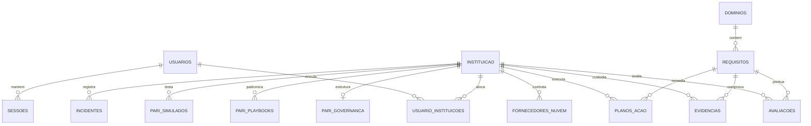

# Arquitetura do Software e Guia Técnico de Conformidade GRC

Sistema Web Especializado para Gestão de Governança, Riscos e Conformidade (GRC) com as Resoluções do Banco Central do Brasil / Conselho Monetário Nacional **CMN nº 4.893/2021** e **CMN nº 5.274/2025**.

---

## 1. Princípios de Engenharia de Software

1. **Autocontido e Zero Dependências Externas em Tempo de Execução:**
   - Construído integralmente com a biblioteca padrão do Python 3 (`http.server`, `sqlite3`, `json`, `hashlib`, `urllib`).
   - Não requer servidores de aplicação pesados ou bibliotecas externas não auditadas, atendendo às mais estritas políticas de segurança de instituições financeiras.
2. **Integridade Criptográfica de Evidências:**
   - Cada evidência registrada recebe cálculo automático de hash **SHA-256** no momento da ingestão, permitindo comprovação pericial de não repúdio e não adulteração perante a auditoria do Banco Central.
3. **Persistência Transacional Confiável (ACID):**
   - Banco de dados relacional embarcado SQLite operando com integridade referencial ativa (`PRAGMA foreign_keys = ON;`), transações atômicas e isolamento.
4. **Interface Moderna Single Page Application (SPA):**
   - Frontend executivo rápido em HTML5, CSS3 moderno e JavaScript ES6+, com suporte nativo a impressão e geração de dossiês em PDF (`window.print()`).

---

## 2. Estrutura do Esquema de Dados (Database Schema)

### Tabelas Principais
* `usuarios`: Gestão centralizada de usuários, senha segura com salt PBKDF2-SHA256 (100.000 iterações), flag de administrador geral global e chave secreta para MFA TOTP (RFC 6238).
* `usuario_instituicoes`: Tabela de amarração de Controle de Acesso Baseado em Papéis (RBAC) granular por instituição (`CHECK(perfil IN ('gestor', 'analista', 'auditor'))`).
* `sessoes`: Controle de sessões ativas com token criptográfico de 256 bits, prazo de expiração e flag de validação de segundo fator (`mfa_verificado`).
* `instituicao`: Cadastro da instituição financeira, CNPJ, segmento S1 a S5, tipo de instituição, registro Unicad e diretor estatutário (Art. 7º).
* `dominios`: Os 7 domínios de governança regulatória.
* `requisitos`: Os 32 requisitos normativos com referência legal, especificação técnica, flag dos 14 controles mandatórios da 5.274 e severidade.
* `avaliacoes`: Status GRC (`atendido`, `parcialmente_atendido`, `em_implementacao`, `nao_atendido`, `nao_aplicavel`), aderência percentual (0 a 100%), justificativa técnica, responsável e observações da auditoria.
* `evidencias`: Cofre de evidências com hash criptográfico SHA-256, tipo de documento, data de coleta e status pericial de validação.
* `pari_governanca`: Estrutura do CSIRT, plantão 24x7, membros, comitê de crise executivo e critérios formais de comunicação ao BACEN.
* `pari_playbooks`: Procedimentos operacionais padronizados por cenário (Ransomware, Vazamento de Dados, DDoS, Nuvem, RSFN/PIX) cobrindo as 5 fases de resposta.
* `pari_simulados`: Histórico de exercícios de mesa (tabletop drills) com a Diretoria, tempo de resposta alcançado e lições aprendidas.
* `planos_acao`: Matriz 5W2H de remediação para gaps regulatórios.
* `fornecedores_nuvem`: Cadastro de provedores (IaaS, PaaS, SaaS) e checklist de conformidade com os Arts. 11 a 17 da Resolução 4.893.
* `incidentes`: Registro de eventos de segurança, criticidade e notificação regulatória no Sisbacen.
* `auditoria_log`: Trilha imutável de todas as modificações realizadas no sistema.

---

## 3. Matriz de Controle de Acesso RBAC (Least Privilege)

| Funcionalidade / Operação | Admin Geral | Gestor (CISO) | Analista (GRC) | Auditor / Fiscal BACEN |
|:---|:---:|:---:|:---:|:---:|
| Gestão Centralizada de Usuários (`/api/usuarios`) | ✅ Total | ❌ Bloqueado | ❌ Bloqueado | ❌ Bloqueado |
| Cadastrar Nova Instituição Financeira | ✅ Total | ❌ Bloqueado | ❌ Bloqueado | ❌ Bloqueado |
| Alterar Dados Cadastrais e Unicad da Empresa | ✅ Total | ✅ Permitido | ❌ Bloqueado | ❌ Bloqueado |
| Atualizar Avaliações de Requisitos GRC | ✅ Total | ✅ Permitido | ✅ Permitido | ❌ Bloqueado (Read-Only) |
| Inserir Novas Evidências no Cofre | ✅ Total | ✅ Permitido | ✅ Permitido | ❌ Bloqueado (Read-Only) |
| Excluir Evidências do Cofre Regulatório | ✅ Total | ✅ Permitido | ❌ Bloqueado | ❌ Bloqueado (Read-Only) |
| Governança do PARI e Plantão CSIRT | ✅ Total | ✅ Permitido | ❌ Bloqueado | ❌ Bloqueado (Read-Only) |
| Cadastrar Playbooks e Simulados de Crise | ✅ Total | ✅ Permitido | ✅ Permitido | ❌ Bloqueado (Read-Only) |
| Gestão de Fornecedores de Nuvem (Art. 17) | ✅ Total | ✅ Permitido | ❌ Bloqueado | ❌ Bloqueado (Read-Only) |
| Consulta ao Dossiê e Relatório Anual (Art. 8º) | ✅ Total | ✅ Permitido | ✅ Permitido | ✅ Permitido (Fiscalização) |
| Acesso às Trilhas Imutáveis de Auditoria | ✅ Total | ✅ Permitido | ✅ Permitido | ✅ Permitido (Fiscalização) |

---

## 4. Especificação da REST API

| Método | Endpoint | Perfil Mínimo | Descrição |
|:-------|:---------|:--------------|:----------|
| `POST` | `/api/auth/login` | Público | Autentica e-mail e senha com PBKDF2 e retorna sessão pendente de MFA |
| `POST` | `/api/auth/mfa` | Público | Valida código TOTP de 6 dígitos (RFC 6238) e libera sessão autenticada |
| `GET` | `/api/auth/me` | Autenticado | Retorna dados do usuário autenticado, perfil ativo e IFs autorizadas |
| `POST` | `/api/auth/logout` | Autenticado | Invalida a sessão ativa |
| `GET` | `/api/usuarios` | Admin Geral | Lista todos os usuários, papéis e instituições vinculadas |
| `POST` | `/api/usuarios` | Admin Geral | Cadastra usuário com perfis RBAC granulares por instituição |
| `PUT` | `/api/usuarios/{id}` | Admin Geral | Atualiza dados, papéis ou revoga acesso de usuário |
| `DELETE`| `/api/usuarios/{id}` | Admin Geral | Exclui usuário do sistema |
| `GET` | `/api/dashboard` | Todos | Retorna métricas globais de conformidade, KPIs e 14 controles da 5.274 |
| `GET` | `/api/instituicoes` | Todos | Lista instituições financeiras autorizadas ao usuário logado |
| `GET` | `/api/instituicao/ativa` | Todos | Retorna dados cadastrais da instituição ativa para avaliação |
| `POST` | `/api/instituicoes` | Admin Geral | Cadastra nova instituição financeira para avaliação |
| `PUT` | `/api/instituicao/{id}` | Gestor / Admin | Atualiza dados cadastrais, segmento, diretor estatutário ou governança |
| `POST` | `/api/instituicao/{id}/ativar` | Todos (se vinculado) | Alterna a instituição ativa para navegação |
| `GET` | `/api/requisitos` | Todos | Lista requisitos com filtros por domínio, status, severidade e busca |
| `PUT` | `/api/avaliacoes/{id}` | Analista / Gestor / Admin | Atualiza status de compliance, percentual de aderência e justificativa |
| `GET` | `/api/evidencias` | Todos | Consulta evidências vinculadas aos requisitos |
| `POST` | `/api/evidencias` | Analista / Gestor / Admin | Registra e anexa nova evidência com cálculo automático de hash SHA-256 |
| `DELETE`| `/api/evidencias/{id}` | Gestor / Admin | Remove evidência do cofre regulatório (Analista e Auditor bloqueados) |
| `GET` | `/api/pari` | Todos | Retorna o dossiê completo do PARI (CSIRT, playbooks, simulados) |
| `PUT` | `/api/pari/governanca` | Gestor / Admin | Atualiza governança do CSIRT, plantão 24x7 e critérios SISBACEN |
| `POST` | `/api/pari/playbooks` | Analista / Gestor / Admin | Cadastra novo playbook operacional de resposta a incidentes |
| `POST` | `/api/pari/simulados` | Analista / Gestor / Admin | Registra realização de exercício de mesa / simulado de crise |
| `GET` | `/api/relatorio_anual` | Todos | Gera o Relatório Anual do Art. 8º da Resolução 4.893 para PDF/impressão |
| `GET` | `/api/export/csv` | Todos | Exporta matriz de conformidade em formato CSV (Excel) |
| `GET` | `/api/export/json` | Todos | Exporta dossiê regulatório estruturado em formato JSON |
